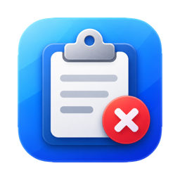
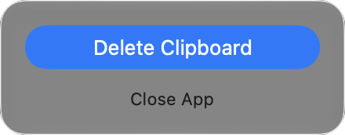

<p align="center">
  
</p>

<h1 align="center">Clipboard Cleaner</h1>

<p align="center">Clear your current clipboard. Get on with your day.</p>
<p align="center">Native macOS app · macOS 13+ · Apple Silicon &amp; Intel</p>

## Features

- **One-click clearing.** Open the menu bar icon and choose **Delete Clipboard**.
- **A minimal interface.** Two buttons, no main window, no Dock icon.
- **Local by design.** No clipboard reading, monitoring, history, analytics, or network requests.
- **Only when you ask.** No automatic clearing and no automatic launch at login.

## Screenshot

<p align="center">
  
</p>

## Privacy

Clipboard Cleaner clears the **active system clipboard** when you click **Delete Clipboard**. The app does not read, store, log, or transmit its contents.

**External clipboard histories are not guaranteed to be removed.** Clipboard managers, other apps, and other devices may already hold their own copies. Clearing the active clipboard does not guarantee deletion of those copies or secure erasure of the underlying data.

The app runs in the macOS App Sandbox without network entitlements.

## Installation

### Build from source

A prebuilt app download is not currently available. Distribution builds will only be offered after Developer ID signing and notarization have been verified.

1. Clone this repository and open `ClipboardCleaner.xcodeproj` in Xcode.
2. Select the **ClipboardCleaner** scheme and **My Mac** as the destination.
3. Build and run. For local use, choose **Sign to Run Locally** if needed.

For a universal Release build from Terminal:

```sh
xcodebuild -project ClipboardCleaner.xcodeproj \
  -scheme ClipboardCleaner -configuration Release \
  -destination 'generic/platform=macOS' -derivedDataPath build \
  CODE_SIGN_IDENTITY=- build
```

Copy `build/Build/Products/Release/ClipboardCleaner.app` to **Applications** and open it. This command creates an ad hoc signed build for local use; it does not produce a notarized distribution app.

### Use

Click the clipboard symbol in the menu bar, then **Delete Clipboard**. Choose **Close App** to quit.

To launch at login, add the app manually in **System Settings → General → Login Items → Open at Login**. The app never enables this itself.

## System requirements

| | Requirement |
| --- | --- |
| macOS | 13 Ventura or later |
| Processor | Apple Silicon or Intel, 64-bit |
| Building | Xcode with a macOS 13+ SDK; verified with Xcode 27.1 |

## License

A license has not been selected yet. No open-source license is granted at this stage.
