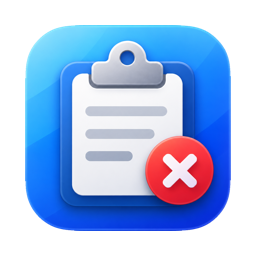
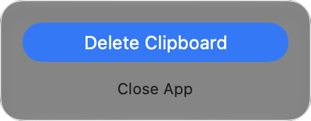

<p align="center">
  
</p>

<h1 align="center">Clipboard Cleaner</h1>
<p align="center">Clear your clipboard from the menu bar. No clutter.</p>

## Features

- Open the menu bar window, then click **Delete Clipboard** to clear the active system clipboard.
- A brief green **✓ Cleared!** confirmation returns to **Delete Clipboard** after about 0.8 seconds; the transition respects Reduce Motion.
- **Close App** quits the app.
- A native menu bar app with no Dock icon, clipboard monitoring, stored history, network requests, or telemetry.

<p align="center">
  
</p>

## Download & Installation

1. [Download the macOS ZIP](https://github.com/Ryukanchi/ClipboardCleaner/releases/download/v1.0.1/ClipboardCleaner-v1.0.1-macOS-unnotarized.zip) and unzip it. It contains **ClipboardCleaner.app** and **LICENSE**.
2. Move **ClipboardCleaner.app** to **Applications**, then open it.

**This build is ad hoc signed, without Apple Developer ID signing or notarization. macOS may block it.** If you trust the source and choose to proceed, follow [Apple's official instructions](https://support.apple.com/en-us/102445) for an app-specific exception in **System Settings → Privacy & Security → Open Anyway**. Keep system security protections enabled.

Optional: add the installed app under **System Settings → General → Login Items → Open at Login** (called **Login Items & Extensions** on newer macOS versions). The app does not register a login item itself.

## Requirements

macOS 13 or later. Apple Silicon or Intel Mac.

## Build from Source

With Xcode installed, run from the repository root:

```sh
xcodebuild -project ClipboardCleaner.xcodeproj \
  -scheme ClipboardCleaner -configuration Release \
  -destination 'generic/platform=macOS' \
  -derivedDataPath build/release -jobs 1 \
  CODE_SIGN_IDENTITY="-" build
```

The universal, ad hoc signed app is at `build/release/Build/Products/Release/ClipboardCleaner.app`. See the [release procedure](docs/RELEASING.md) for packaging and verification.

## Continuous integration

[](https://github.com/Ryukanchi/ClipboardCleaner/actions/workflows/macos-build.yml)

GitHub Actions builds the universal Release app on `macos-15` with Xcode 26.3 for pushes and pull requests to `main`. It checks the expected version/build, macOS deployment target, both binary architectures and their minimum OS, strict ad hoc signature, Hardened Runtime, App Sandbox, and `LSUIElement` metadata.

CI does not launch the app or test its UI, buttons, animation, real Intel hardware, or a real macOS 13 system. It does not publish releases or upload build artifacts.

## Privacy

Only the active system clipboard is cleared, and only when you click **Delete Clipboard**. Launching the app does not clear it. Copies in clipboard managers, other apps, or other devices may remain; this is not a secure-erasure guarantee. The app does not monitor, read, store, or transmit clipboard contents.

## License

[MIT](LICENSE). Copyright © 2026 Ryukanchi.
